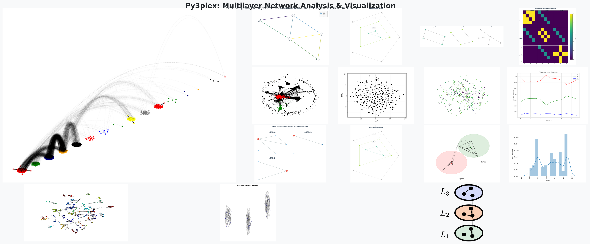

[](https://github.com/SkBlaz/py3plex/actions/workflows/tests.yml)
[](https://github.com/SkBlaz/py3plex/actions/workflows/tests.yml)
[](https://github.com/SkBlaz/py3plex/actions/workflows/type-coverage.yml)
[](https://github.com/SkBlaz/py3plex/actions/workflows/examples.yml)
[](https://github.com/SkBlaz/py3plex/actions/workflows/tutorial-validation.yml)
[](https://github.com/SkBlaz/py3plex/actions/workflows/code-quality.yml)
[](https://github.com/SkBlaz/py3plex/actions/workflows/benchmarks.yml)
[](https://github.com/SkBlaz/py3plex/actions/workflows/doc-coverage.yml)
[](https://github.com/SkBlaz/py3plex/actions/workflows/verify.yml)
[](https://github.com/SkBlaz/py3plex/actions/workflows/formal.yml)
[](https://github.com/SkBlaz/py3plex/actions/workflows/fuzzing.yml)
[](https://pypi.org/project/py3plex/)
[](https://pypistats.org/packages/py3plex)


*Multilayer networks* are complex networks with additional information assigned to nodes or edges (or both). This library includes
some of the state-of-the-art algorithms for decomposition, visualization and analysis of such networks.

**Key Features:**
* SQL-like DSL for intuitive network queries with smart defaults
* Multilayer network visualization and analysis
* Community detection and centrality measures
* Network decomposition and embeddings


```python
from py3plex.datasets import make_random_multiplex
from py3plex.dsl import Q

network = make_random_multiplex(
    n_nodes=24, n_layers=3, p=0.25, random_state=42,
)

assignments = (
    Q.communities().auto(fast=True, seed=42).execute(network)
    .to_pandas()[["node", "layer", "community"]]
    .rename(columns={"node": "id"})
)

hubs = (
    Q.nodes()
    .compute("betweenness_centrality")
    .per_layer()
    .top_k(8, "betweenness_centrality")
    .end_grouping()
    .coverage(mode="at_least", k=2)
    .execute(network)
)
estimates = (
    Q.nodes()
    .uq(method="perturbation", n_samples=20, ci=0.95, seed=42)
    .compute("betweenness_centrality", "pagerank", "degree_centrality")
    .explain(neighbors_top=5)
    .execute(network)
)

selected = hubs.to_pandas()[["id", "layer"]]
df = selected.merge(
    estimates.to_pandas(expand_uncertainty=True, expand_explanations=True),
    on=["id", "layer"],
    validate="one_to_one",
).merge(assignments, on=["id", "layer"], validate="one_to_one")
df["score"] = (
    0.5 * df["betweenness_centrality"]
    + 0.3 * df["pagerank"]
    + 0.2 * df["degree_centrality"]
)
print(df.sort_values("score", ascending=False)[[
    "id", "layer", "community", "betweenness_centrality",
    "betweenness_centrality_ci95_low", "betweenness_centrality_ci95_high",
    "score", "top_neighbors",
]].head(10))
```

This example detects communities on a seeded synthetic multiplex and ranks
candidate hubs. The hub query selects the top eight replicas per layer and
keeps nodes represented among those selections in at least two layers. The
final table combines community assignments, centrality estimates, and
neighbor explanations for each retained replica.
The exported table stores the mean in `betweenness_centrality` and the
interval endpoints in the `_ci95_low` and `_ci95_high` columns.

### Ecosystem positioning

| Comparator | Focus | py3plex 2.0 relation |
|---|---|---|
| **py3plex 2019** | Early py3plex multilayer analysis + visualization | Historical base; 2.0 expands into reproducible DSL/workflow-first analysis. |
| **pymnet** | Formal multilayer modeling and metrics | Strongest Python formal multilayer peer; py3plex emphasizes workflows, UQ, and reproducibility. |
| **MultiNetX** | Lightweight NetworkX-style multilayer utilities | Similar graph object tooling; py3plex offers broader end-to-end analysis workflows. |
| **muxViz** | Visual multilayer analytics (R ecosystem) | Strong visual analytics peer; py3plex emphasizes scriptable Python workflows. |
| **R `multinet`** | Multiplex social-network mining | Social-network-focused peer; py3plex targets broader heterogeneous multilayer science use cases. |
| **tnetwork / DyNetx** | Temporal and dynamic graph workflows | Temporal overlap; py3plex adds multilayer semantics, DSL querying, and integrated dynamics. |
| **Reticula / Raphtory / pathpy** | Temporal-engine and path-centric ecosystems | Strong temporal/path engines; py3plex focuses on multilayer workflow integration and analyst ergonomics. |
| **NetworkX / igraph / graph-tool** | General-purpose graph analysis stacks | Core graph ecosystem overlap; py3plex adds layer-aware abstractions and reproducible multilayer workflows. |
| **tidygraph** | Fluent graph-as-table manipulation | Similar analyst grammar style; py3plex adapts it to Python multilayer semantics. |
| **NDlib** | Diffusion and epidemic simulation | Dynamics overlap; py3plex embeds dynamics inside multilayer, queryable, uncertainty-aware pipelines. |
| **PyTorch Geometric / DGL** | Graph deep learning frameworks | Adjacent graph-ML layer; py3plex focuses on preparation, querying, and scientific analysis workflows. |
| **Neo4j / Cypher** | Persistent property-graph querying | Query overlap; py3plex provides in-memory scientific multilayer DSL + metrics + exports. |
| **py3plex 2.0** | Query-driven reproducible multilayer analysis | Python-native workflow layer: DSL/builder API, layer algebra, UQ, temporal/dynamics, null models, and CLI. |



## Getting Started

### Installation

We recommend using [uv](https://docs.astral.sh/uv/) for fast, reliable Python environment management:

```bash
# Install uv (if not already installed)
curl -LsSf https://astral.sh/uv/install.sh | sh

# Create and activate virtual environment
uv venv .venv
source .venv/bin/activate  # On Windows: .venv\Scripts\activate

# Install py3plex
uv pip install py3plex

# Or install from source with development dependencies
uv pip install -e ".[dev]"
```

Alternatively, use pip:
```bash
pip install py3plex
```

### Optional Features

Install additional features as needed:

```bash
# MCP server for AI agent integration (requires Python 3.10+)
pip install py3plex[mcp]

# Community detection algorithms
pip install py3plex[algos]

# Advanced visualization
pip install py3plex[viz]

# All optional features
pip install py3plex[mcp,algos,viz]

# Common optional feature bundle (algorithms + visualization + workflows + arrow + mcp)
pip install py3plex[optional]
```

### Contributing (First PR Quick Path)

If this is your first contribution, use this sequence:

```bash
# 1) Create local dev environment and install package
make setup
make dev-install

# 2) Run formatting and checks before opening a PR
make format
make lint
make test
```

Helpful commands:

```bash
make help   # List all project commands
make ci     # Run lint + tests in CI-style order
```

Safety notes for contributors:
- Keep changes focused and add tests next to the feature you modify.
- Do not add new markdown files unless explicitly requested (enforced by `tests/test_link_checker.py` to prevent documentation drift).
- Prefer running targeted tests first, then broader checks before opening a PR.
- For docs-only updates, run `make docs-check` before opening a PR.

To report a bug, request a feature, or ask for help using py3plex, open an issue in the [issue tracker](https://github.com/SkBlaz/py3plex/issues). Include a minimal example and the py3plex and Python versions where relevant.

### MCP Integration (AI Agents)

py3plex provides a Model Context Protocol (MCP) server for integration with AI coding assistants:

**Requirements**: Python 3.10 or higher (due to MCP SDK dependency)

```bash
# Install with MCP support (Python 3.10+ required)
pip install py3plex[mcp]

# Start MCP server
py3plex-mcp
```

**Configure Claude Desktop** (`claude_desktop_config.json`):
```json
{
  "mcpServers": {
    "py3plex": {
      "command": "py3plex-mcp"
    }
  }
}
```

The MCP server exposes:
- **7 tools**: Load networks, run queries (with DSL v2 support), detect communities, export results, and more
- **3 resources**: Complete documentation, DSL v2 reference, and tool schemas
- **DSL v2 support**: Modern builder API with type hints (`Q.nodes().where(degree__gt=5).compute('pagerank')`)
- **Security-first**: Safe file access, automatic output directory, structured errors

See [AGENTS.md](AGENTS.md#mcp-integration-model-context-protocol) for complete MCP documentation including DSL v2 examples.

### Resources

* **Documentation:** [https://skblaz.github.io/py3plex/](https://skblaz.github.io/py3plex/)
* **Technical Book (PDF):** [Practical Multilayer Network Analysis with Py3plex](docs/py3plex_book.pdf) - Complete handbook (106 pages)
* **Examples:** [examples/](examples/) - 170+ example scripts demonstrating usage

## License

Py3plex is released under the [MIT License](LICENSE).

**Note on licensing:** Prior to version 1.0, the project was distributed under the BSD-3-Clause license. Starting with version 1.0, the license was changed to MIT to better align with the broader Python scientific ecosystem and simplify contribution and reuse. Both licenses are permissive and OSI-approved.

# Citations
```
@Article{Skrlj2019,
author={Skrlj, Blaz
and Kralj, Jan
and Lavrac, Nada},
title={Py3plex toolkit for visualization and analysis of multilayer networks},
journal={Applied Network Science},
year={2019},
volume={4},
number={1},
pages={94},
abstract={Complex networks are used as means for representing multimodal, real-life systems. With increasing amounts of data that lead to large multilayer networks consisting of different node and edge types, that can also be subject to temporal change, there is an increasing need for versatile visualization and analysis software. This work presents a lightweight Python library, Py3plex, which focuses on the visualization and analysis of multilayer networks. The library implements a set of simple graphical primitives supporting intra- as well as inter-layer visualization. It also supports many common operations on multilayer networks, such as aggregation, slicing, indexing, traversal, and more. The paper also focuses on how node embeddings can be used to speed up contemporary (multilayer) layout computation. The library's functionality is showcased on both real and synthetic networks.},
issn={2364-8228},
doi={10.1007/s41109-019-0203-7},
url={https://doi.org/10.1007/s41109-019-0203-7}
}
```
and
```
@InProceedings{10.1007/978-3-030-05411-3_60,
author="{\v{S}}krlj, Bla{\v{z}}
and Kralj, Jan
and Lavra{\v{c}}, Nada",
editor="Aiello, Luca Maria
and Cherifi, Chantal
and Cherifi, Hocine
and Lambiotte, Renaud
and Li{\'o}, Pietro
and Rocha, Luis M.",
title="Py3plex: A Library for Scalable Multilayer Network Analysis and Visualization",
booktitle="Complex Networks and Their Applications VII",
year="2019",
publisher="Springer International Publishing",
address="Cham",
pages="757--768",
abstract="Real-life systems are commonly represented as networks of interacting entities. While homogeneous networks consist of nodes of a single node type, multilayer networks are characterized by multiple types of nodes or edges, all present in the same system. Analysis and visualization of such networks represent a challenge for real-life complex network applications. The presented Py3plex Python-based library facilitates the exploration and visualization of multilayer networks. The library includes a diagonal projection-based network visualization, developed specifically for large networks with multiple node (and edge) types. The library also includes state-of-the-art methods for network decomposition and statistical analysis. The Py3plex functionality is showcased on real-world multilayer networks from the domains of biology and on synthetic networks.",
isbn="978-3-030-05411-3"
}
```
